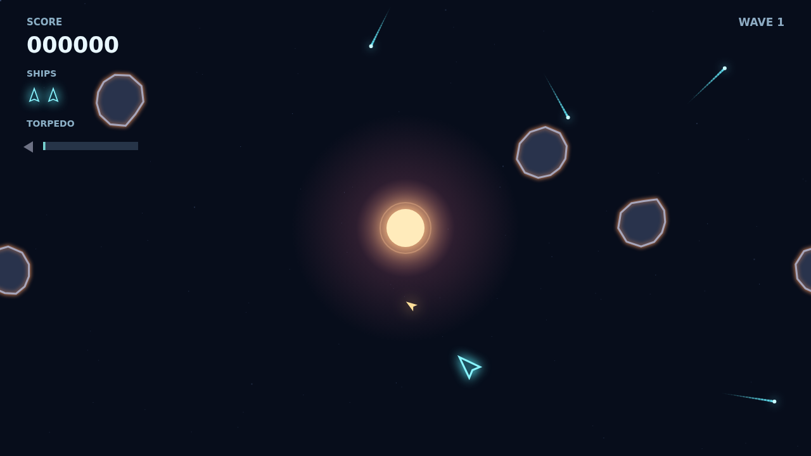

# Shatter

Fly a small ship through a field of armored space rock. Turn, thrust, and coast under your own momentum while you break each boulder into smaller fragments. Clear every fragment and the next wave arrives denser and faster.

A bright star anchors the field. Its gravity curves bullets and rocks around the core, opening shots you could never make in a straight line. Watch a round curl toward a target on the far side, or lure a rock into the star and meet it when it returns from the edge.

Large rocks withstand several gun hits and show their scars. When one refuses to break, launch your single guided torpedo. It searches a narrow cone ahead, holds its course through the well, and shatters any rock outright. The charge takes ten seconds to return.

Keep moving when the saucer comes hunting. Its shots bend under the same gravity, and every wave asks you to read the whole field before you fire.

